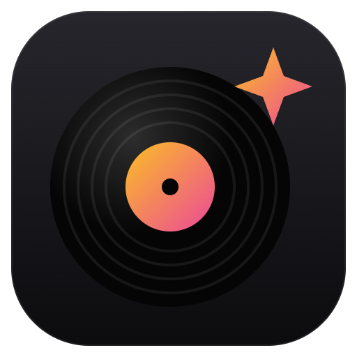
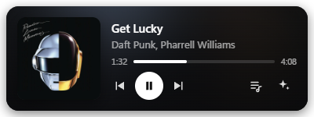
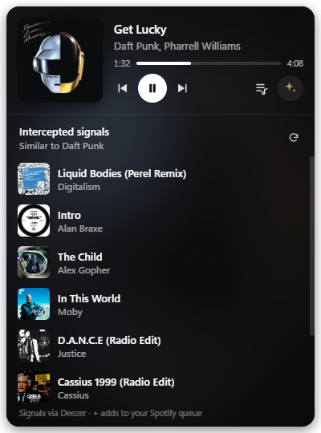
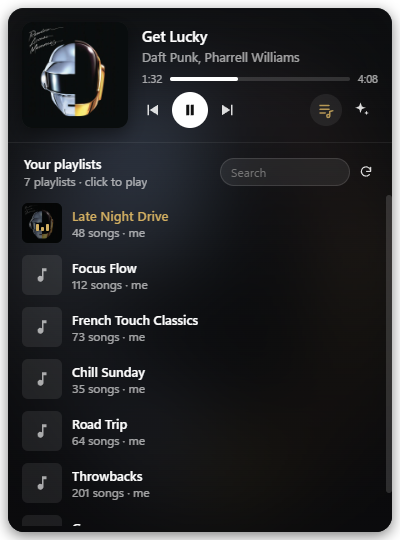

<p align="center">
  
</p>

<h1 align="center">Voxcaster</h1>

<p align="center">
  <em>Transmitting on all frequencies.</em><br>
  A small, always-on-top desktop player for Spotify on Windows, with song discovery and quick playlist switching.
</p>

<p align="center">
  
</p>

<p align="center">
  
  &nbsp;
  
</p>

## Features

- **Now playing**: album art, title, artist and a seekable progress bar, with colors that adapt to each cover
- **Controls**: play/pause, next, previous (Space, ← and → work too)
- **Intercepted signals**: songs from artists similar to what's playing, with 30-second previews and one-click *add to queue*
- **Playlists**: search your playlists, click to play, or shuffle-play
- **Stays out of the way**: frameless, draggable from anywhere, pin on top, remembers its position
- **Starts with Windows** (toggle in the ⋯ menu)

## Install

Download `Voxcaster-Setup-x.y.z.exe` from the [latest release](../../releases/latest) and run it. It installs for your user only (no admin rights needed) and adds Start Menu and desktop shortcuts.

The installer isn't code-signed, so Windows SmartScreen may warn the first time: click **More info → Run anyway**.

## First-run setup

Spotify requires each user to bring their own (free) API app. The player walks you through it:

1. Open the [Spotify Developer Dashboard](https://developer.spotify.com/dashboard) and click **Create app**.
2. Add `http://127.0.0.1:8888/callback` as a **Redirect URI** and tick **Web API**.
3. Copy the **Client ID** into the player and click **Connect Spotify**.

Playback control needs **Spotify Premium** (a Spotify API rule). Login uses PKCE, so no client secret is stored. Tokens are kept locally in `%APPDATA%\voxcaster\config.json`.

## Development

Requires [Node.js](https://nodejs.org/) 20+.

```bash
npm install
npm start          # run from source
npm run dist       # build the Windows installer into dist/
```

| File | Purpose |
| --- | --- |
| `main.js` | Electron main process: window, Spotify auth and Web API, Deezer discovery, auto-start |
| `media-bridge.ps1` | Reads now-playing from Windows' media controls and sends play/pause/skip |
| `preload.js` | Safe bridge between the page and the main process |
| `index.html`, `styles.css`, `renderer.js` | The player UI |
| `assets/icon.svg` | App icon source (`icon.png` is rendered from it) |

## Notes

- **Now playing comes from Windows, not the Spotify API.** `media-bridge.ps1` reads the Spotify app's track, play state, position and album art from Windows' media controls (the same info as the volume flyout), and sends play/pause/skip back the same way. The Web API is only used for playlists, discovery, queueing, seeking, and one lookup per track for the Spotify link and current playlist. When Spotify isn't playing on this PC (e.g. on your phone), the player falls back to polling the API sparingly and backs off when Spotify asks it to.

- Spotify removed its recommendations API for new apps in 2024, so suggestions come from [Deezer's public API](https://developers.deezer.com/api) and are matched back to Spotify when you queue them.
- Liked Songs and Spotify-made playlists (like Discover Weekly) aren't available through the API for new apps.

This is a personal fan project. It is not affiliated with or endorsed by Spotify or Games Workshop. Spotify is a trademark of Spotify AB.

## License

[MIT](LICENSE)
